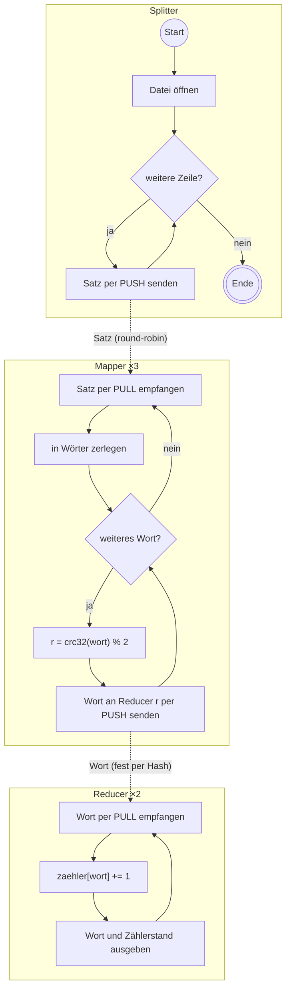

# Lab 3 – Wordcount mit 0MQ-Pipeline

Verteilter Wordcount nach dem MapReduce-Prinzip: 1 Splitter, 3 Mapper, 2 Reducer.
Alle Verbindungen nutzen das Pipeline-Muster (PUSH/PULL).

## Datenfluss (Aktivitätsdiagramm)

Jede Swimlane ist ein Prozess, die gestrichelten Kanten sind 0MQ-Nachrichten.
Als UML-Aktivitätsdiagramm für Visual Paradigm / PlantUML: [`wordcount.puml`](wordcount.puml).



## Sockets

| Verbindung        | Sender                         | Empfänger                      | Port  |
|-------------------|--------------------------------|--------------------------------|-------|
| Splitter → Mapper | Splitter: PUSH `bind`          | Mapper: PULL `connect`         | 50020 |
| Mapper → Reducer 0 | Mapper: PUSH `connect`        | Reducer 0: PULL `bind`         | 50021 |
| Mapper → Reducer 1 | Mapper: PUSH `connect`        | Reducer 1: PULL `bind`         | 50022 |

- Jeder Mapper hat **zwei** PUSH-Sockets (einen pro Reducer). Ein gemeinsamer
  Socket würde reihum verteilen, und gleiche Wörter landeten bei verschiedenen Reducern.
- Zur Zuordnung `zlib.crc32` statt `hash()`, weil `hash()` in jedem Prozess
  anders initialisiert wird.
- Startreihenfolge: Reducer → Mapper → Splitter. Sonst bekommt der erste
  verbundene Mapper alle Sätze.

## Starten

IPs und Ports stehen in `constWordcount.py`. Jeder Befehl in einem eigenen Terminal:

```bash
pipenv run python reducer.py 0
pipenv run python reducer.py 1
pipenv run python mapper.py 1
pipenv run python mapper.py 2
pipenv run python mapper.py 3
pipenv run python splitter.py text.txt   # Dateipfad optional, Default: text.txt
```

Reducer und Mapper laufen endlos und werden mit `Strg+C` beendet.
